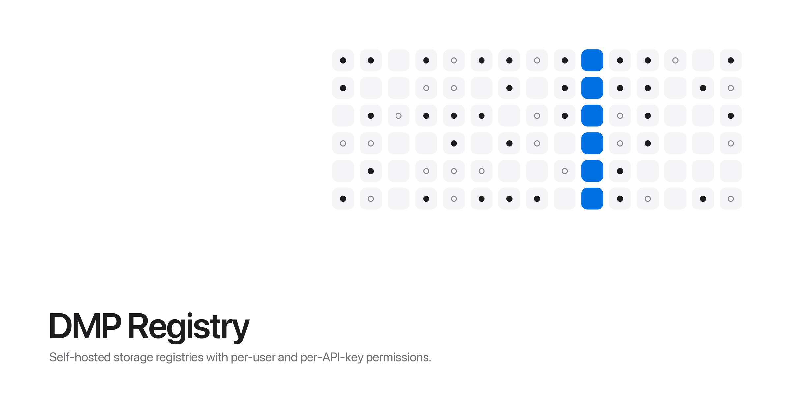

# DMP Registry Frontend



DMP Registry is a self-hosted platform for creating storage "registries" and controlling who can use each one. A registry is a file store, a typed key-value store, a SQLite database, or a MongoDB database. Access is granted per registry to signed-in users and to API-key "agents", so a program can read and write a registry without a user account.

This repo is the web app. It's a single-page React app that talks only to the backend API. The other two services are:

- [dmp-registry-backend](https://github.com/dylan-mccormick/dmp-registry-backend): the Express API, which handles accounts, permissions, and each registry's data API
- [dmp-registry-db-api](https://github.com/dylan-mccormick/dmp-registry-db-api): an internal HTTP API over the MySQL database, used only by the backend

## Features

- Sign up, sign in, and manage your account: change your username, email, or password, sign out, or delete the account.
- A dashboard of the registries you can read, and a form to create a new one (needs the global `CREATE_REGISTRY` permission).
- A data view for each registry type:
  - **Files**: browse folders, upload and download files, create folders, delete, view file details, and toggle whether a file is public.
  - **Key-value**: add, edit, and delete typed keys.
  - **SQLite**: create and drop tables, and add, edit, and delete rows.
  - **MongoDB**: create and drop collections, filter documents with a JSON query, and add, edit, and delete documents in a JSON editor.
- Registry user management: search for users, add or remove them, and set their registry permissions.
- Agent management: create agents, set their permissions, rename them, regenerate their API keys, and delete them. A new key is shown once, when it's created or regenerated.
- Registry settings for the owner: rename the registry, or delete it after confirming with a password.
- Admin pages for users with the global `MANAGE_USERS` permission: list and edit users, set their global permissions, and view all registries.

Navigation follows the backend's permissions. Global links come from the user's global permissions, and registry links come from their permissions on that registry, so users only see the pages they can use. The backend still enforces every check.

The registry Audit Log page is a placeholder for now and doesn't show any events yet.

## How it works

- **Stack**: React 19, TypeScript, Vite, React Router 7, Tailwind CSS v4, and `lucide-react` icons.
- **API calls**: `src/apiClient.ts` is a small `fetch` wrapper that prefixes `VITE_API_URL` and sends `credentials: 'include'`, so the backend's `httpOnly` session cookie goes with every request. Account and registry management use `/api/v1/...`, and registry data uses each registry's own routes at `/r/<registryId>/api/v1/...`.
- **State**: React contexts hold the signed-in user, the open registry and your permissions on it, banners, loading state, and a global modal. They're composed in `App.tsx`.
- **Registry views**: `RegistryDashboard` picks a controller from `src/components/registryControllers/` based on the registry's type.
- **Accessibility**: the UI was audited against WCAG 2.2 AA, and the color tokens were picked to pass its contrast ratios. Modals use the native `<dialog>` element, which handles focus trapping and Escape.

## Routes

| Path | Page |
|---|---|
| `/`, `/home` | Landing page |
| `/login`, `/register` | Sign in and sign up |
| `/dashboard` | Your registries |
| `/profile` | Account settings |
| `/registries/new` | Create a registry |
| `/registries/:registryId` | The registry's data view |
| `/registries/:registryId/users` | Registry user management |
| `/registries/:registryId/agents`, `.../agents/new`, `.../agents/:agentId/edit` | Agent management |
| `/registries/:registryId/settings` | Rename or delete the registry |
| `/registries/:registryId/logs` | Audit log (placeholder) |
| `/users`, `/user/:id/edit` | User administration |
| `/admin/registries` | All registries |

Every route except the landing, sign-in, and sign-up pages redirects to `/home` when nobody is signed in.

## Configuration

| Variable | Purpose |
|---|---|
| `VITE_API_URL` | Base URL of the backend API, for example `http://localhost:PORT` |

Vite reads it from `.env.development` or `.env.production` (both gitignored) and bakes it into the build. The Docker build takes it as a build argument.

## Running locally

Requirements: Node, and a running [backend](https://github.com/dylan-mccormick/dmp-registry-backend) whose CORS settings allow your dev server's origin (`http://localhost` on any port is allowed).

```sh
npm install
npm run dev       # Vite dev server, listening on all interfaces
npm run build     # type-check with tsc, then build to dist/
npm run lint      # ESLint
npm run preview   # serve the built dist/
```

There's no test suite. `npm run build` and `npm run lint` are the checks.

## Deployment

The Dockerfile has two stages. A Node stage runs `npm run build` with `VITE_API_URL` passed in as a build argument, and an nginx stage serves `dist/` on port 80. `nginx.conf` falls back to `index.html` for client-side routes and allows request bodies up to 50 MB, which matches the backend's upload limit.

Every push to `main` runs `.github/workflows/deploy.yml`. It builds the image with the production API URL, pushes it to GHCR as `dmp-registry-frontend:latest`, and then connects to the server over SSH to run `docker compose pull frontend` and `docker compose up -d frontend`.
